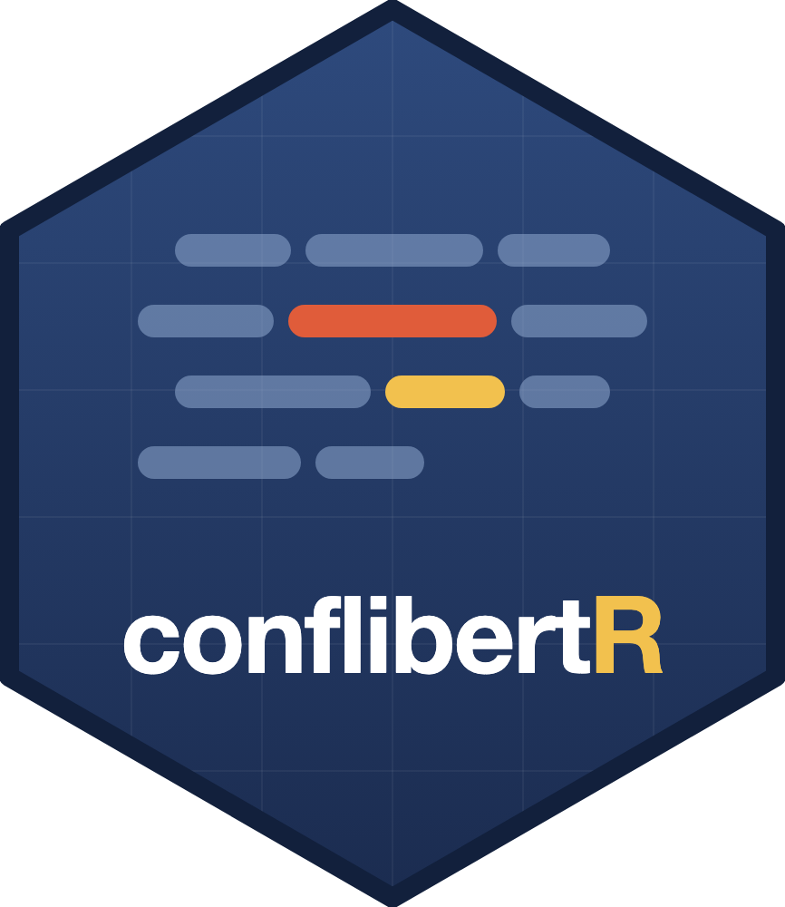

::: {.pattern .pattern-band data-seed="88"}
:::

[Research software for computational conflict analysis and Dutch politics. Everything is open source; bug reports and contributions are welcome on GitHub.]{.page-intro}

## Tools

::: {.soft}
::: {.soft-mark}
[{fig-alt="conflibertR hex logo"}](software/conflibertr.qmd)
:::

::: {}
### conflibertR

An R package bringing [ConfliBERT](https://eventdata.utdallas.edu/), the NSF-funded language model for political conflict and violence, to the R ecosystem: entity recognition, event classification, question answering, fine-tuning, model comparison, and active learning, all from R. On CRAN since July 2026.

::: {.pub-links}
[Package page](software/conflibertr.qmd) [CRAN](https://CRAN.R-project.org/package=conflibertR) [GitHub](https://github.com/shreyasmeher/conflibertR) [Cheatsheet (PDF)](software/conflibertR-cheatsheet.pdf) [Paper](https://doi.org/10.1017/pan.2025.10027)
:::
:::
:::

::: {.soft}
::: {.soft-mark}
::: {.pattern .pattern-tile data-seed="2008" data-density="2.4"}
:::
:::

::: {}
### NL Agent Explorer

Interactive explorer of agent-level data on Dutch national politics, 2008 to 2025: every Tweede Kamer member and cabinet minister with offices held, party and parliamentary group, background, committee seats, bills sponsored with their Tweede Kamer topics and Raad van State advice, and a yearly stance on executive power estimated from plenary speech. Built for the TWIN4DEM project.

::: {.pub-links}
[Open the explorer](https://shreyasmeher.com/nl-agent-explorer/)
:::
:::
:::

::: {.soft}
::: {.soft-mark}
::: {.pattern .pattern-tile data-seed="4242" data-density="2.4"}
:::
:::

::: {}
### ConfliBERT GUI

Browser-based NLP toolkit for conflict and political violence text analysis: named entity recognition, classification, question answering, and LoRA/QLoRA fine-tuning.

::: {.pub-links}
[GitHub](https://github.com/shreyasmeher/ConfliBERT-gui)
:::
:::
:::

## Fine-tuned language models

Open-weight models for conflict and political text, all on [Hugging Face](https://huggingface.co/shreyasmeher).

::: {.models}
::: {.model}
### ConflLlama
Llama 3 8B fine-tuned on the Global Terrorism Database for attack-type classification. Also available with a more neutral chat template and in four time-period variants.

::: {.pub-links}
[Hugging Face](https://huggingface.co/shreyasmeher/ConflLlama) [Paper](https://doi.org/10.1177/20531680251356282)
:::
:::

::: {.model}
### ConflLlama-NER
Llama 3.1 8B Instruct fine-tuned for named entity recognition in conflict event narratives: the source, target, and related actors of each event.

::: {.pub-links}
[Hugging Face](https://huggingface.co/shreyasmeher/ConflLlama-NER)
:::
:::

::: {.model}
### ConflLlama-NER-TOI
Named entity recognition for Indian news (locations, organisations, people, and time expressions), trained on 100,000 Times of India articles.

::: {.pub-links}
[Hugging Face](https://huggingface.co/shreyasmeher/ConflLlama-NER-TOI)
:::
:::

::: {.model}
### Qwen-GLOCON-Reasoning
Qwen2.5-3B trained with GRPO reinforcement learning to classify conflict events into five categories with structured reasoning.

::: {.pub-links}
[Hugging Face](https://huggingface.co/shreyasmeher/Qwen-GLOCON-Reasoning)
:::
:::

::: {.model}
### Confli-mBERT
ModernBERT fine-tuned on the Global Terrorism Database for conflict event classification; companion model to the paper on NLP model selection in computational social science.

::: {.pub-links}
[Hugging Face](https://huggingface.co/shreyasmeher/Confli-mBERT)
:::
:::
:::
